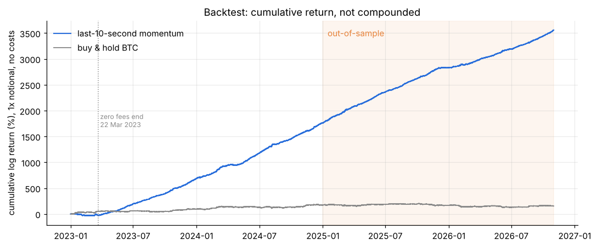
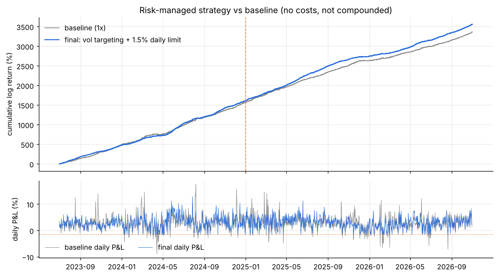

# BTC/USDT 1-second klines: last-10-second momentum

Take-home project for 21Shares (Capital Markets & Trading), by Siyun (Irene) Wang.

**Task.** Using Python and publicly available APIs, retrieve BTC/USDT 1-second kline data since January 2023, then build and backtest a profitable trading strategy based solely on the pulled data (transaction costs not required).

**Summary.** Since Binance ended zero-fee BTC/USDT trading on 22 March 2023, short-term price moves tend to continue for a few seconds. I trade in the direction of the **last 10 seconds of each minute** and hold for one minute (any window from 2 to 30 seconds works; in-sample data selects 10 seconds). The rule is profitable before costs in every year after the break, in-sample (2023–24) and out-of-sample (2025–Oct 2026). A risk-management layer (volatility-targeted sizing and a 1.5% daily loss limit) cuts the worst day from about −7% to −1.7% with the same edge per trade. The edge is about 0.2 bp per minute, roughly equal to the breakeven cost, so its most practical use is **execution timing** for trades a desk has to make anyway.

## Results (before transaction costs, 1× notional, not compounded)

| | Baseline 2023–24 (in-sample) | Baseline 2025–Oct 2026 (out-of-sample) | Final, risk-managed 2025–Oct 2026 | Buy & hold 2025–Oct 2026 |
|---|---|---|---|---|
| Avg bp per minute | 0.17 | 0.19 | 0.20 | 0.00 |
| Breakeven cost per unit traded | 0.18 bp | 0.20 bp | 0.21 bp | n/a |
| Newey-West t-stat of mean return | 25 | 30 | | |
| Worst day | | −7.1% | −1.7% | −14.9% |
| Max drawdown (log %) | | −20 | −7.6 | −78 |
| Sharpe (annualised, minute data) | 18.6 | 22.7 | 34.6 | −0.2 |

Sharpe ratios on minute data before costs look very large; bp per minute and breakeven cost are the more meaningful numbers.




## Repository

| File | Contents |
|---|---|
| `01_retrieve_and_process_data.ipynb` | Downloads every monthly 1-second kline file (Jan 2023 – Oct 2026) from Binance Public Data, verifies SHA-256 checksums, cleans the data and aggregates it to 1-minute bars with 1-second features |
| `02_strategy_backtest.ipynb` | Patterns in the data, formal time-series tests, strategy and backtest, robustness, risk management, comparison with classic strategies, market context, costs, conclusions (saved with all outputs) |
| `03_signal_window_sensitivity.ipynb` | Robustness check: re-downloads the 1-second data and repeats the strategy with signal windows of 2, 5, 10, 20 and 30 seconds, plus variance ratios at 2–60 seconds (saved with all outputs) |
| `Presentation.pdf` | Slides summarising the project |
| `fig_*.png` | Charts produced by notebooks 02 and 03 |
| `requirements.txt` | Python packages used |

## How to run

```bash
pip install -r requirements.txt
jupyter notebook
```
Run `01_retrieve_and_process_data.ipynb` first. It creates `data_1min/` (about 210 MB; the full download took under 20 minutes). Then run `02_strategy_backtest.ipynb`, and optionally `03_signal_window_sensitivity.ipynb` (about 10 minutes, creates `data_windows/`). Data files (`data_1min/`, `data_windows/`) are not stored in the repository because notebook 01 regenerates them. Notebooks 02 and 03 are saved with their outputs, so the results can be read without running anything.

## Data

- **Source:** [Binance Public Data](https://data.binance.vision), the official bulk archive of the `/api/v3/klines` endpoint (BTCUSDT spot, 1s interval). The REST endpoint returns at most 1,000 klines per request, so bulk monthly files are far more efficient for ~121 million rows.
- **Scale:** 120,951,229 one-second klines in 46 monthly files, all checksums verified.
- **Processing:** each month is processed in memory and reduced to 1-minute bars, keeping features that need 1-second data (realized variance, last-10-second return, active seconds, largest 1-second move).
- **Quality checks:** 0 duplicate rows, 0 rows failing OHLC logic, 8,771 missing seconds (all in Jan–Mar 2023) filled by carrying the last price with zero volume. Binance's switch from millisecond to microsecond timestamps on 1 Jan 2025 is handled. Volumes reconcile between the 1-second and 1-minute data.

## Findings

1. **Structural break on 22 March 2023.** When Binance ended zero-fee BTC trading, trades per day fell from about 9.9 million to 1.3 million, seconds with no trades rose from 0.1% to 5.6%, and the lag-1 autocorrelation of 1-second returns flipped from negative (bid-ask bounce) to positive.
2. **Short-horizon momentum.** Since April 2023 the variance ratio is above 1 from 2 seconds to 1 hour (median month 1.12 at 2 s, 1.26 at 5 s, 1.34 at 10 s, ≈ 1.5 at 1–60 min). The Cowles–Jones ratio is 0.94 before the break and 1.06 after.
3. **The information sits in the last seconds.** The last 10 seconds of a minute predict the next minute about twice as well as the whole minute; entering one minute late removes the edge.
4. **Volatility clusters strongly** (Ljung-Box and ARCH LM tests, GARCH(1,1) with α + β ≈ 0.99), which motivates volatility-targeted position sizing.

## Robustness and risk

- Positive in every calendar year (0.13–0.20 bp per minute); loses money in the zero-fee period, as the pattern predicts.
- Both long and short legs are profitable, so it is not a disguised long-BTC position.
- Every signal window from 2 to 30 seconds is profitable in both periods (notebook 03); the edge is highest for 5–10 seconds, so the result does not depend on the exact window.
- One parameter in the signal, the window length; selecting it on in-sample data alone gives 10 seconds. About 20 variants were compared in total; in-sample data alone selects the same signal, and its t-statistics (25–30) are far above a Bonferroni-adjusted threshold (≈ 3.0).
- Risk management: position size = σ_ref / σ_recent (capped at 2×, reference = median of the previous 90 days), plus a stop for the day after a 1.5% loss, calibrated to the strategy's daily volatility.
- Compared with buy & hold, time-series momentum, MA crossover, Donchian breakout, RSI and hourly momentum on the same data, before costs.

## Limitations and next steps

- Execution assumed at the minute close with no latency or slippage; one venue; no order-book data.
- About 490,000 position changes a year; net performance is zero at about 0.2 bp per unit traded, versus Binance's standard 10 bp spot fee.
- Next steps: volatility-scaled take-profit and stop-loss, latency test, maker execution with order-book data, HAR-RV or intraday GARCH volatility models, and a formal Reality Check / SPA test.
